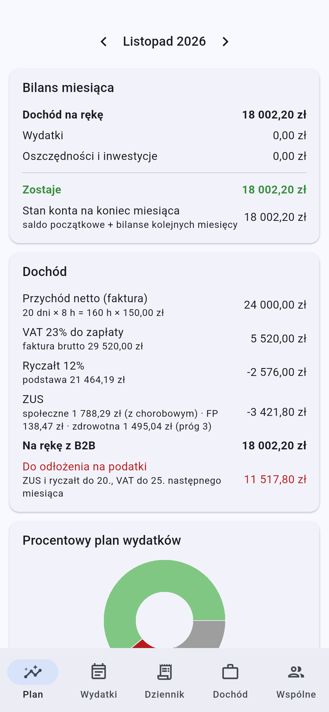
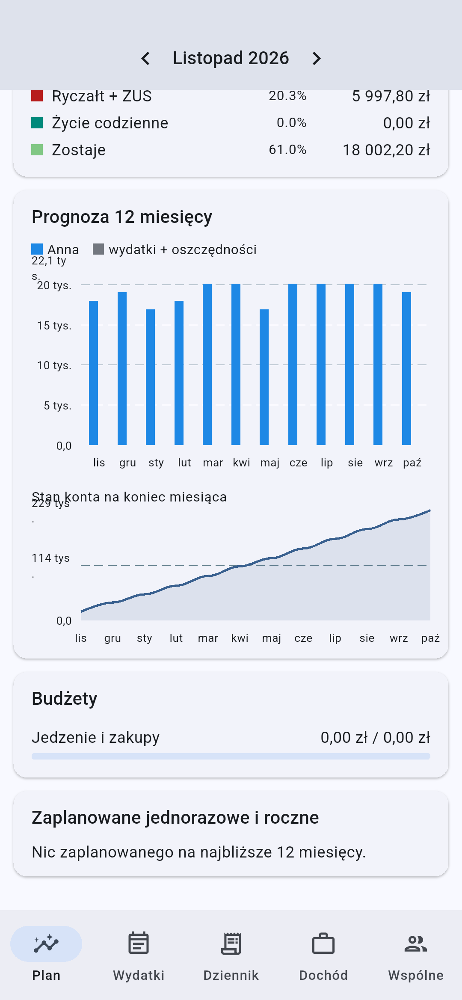
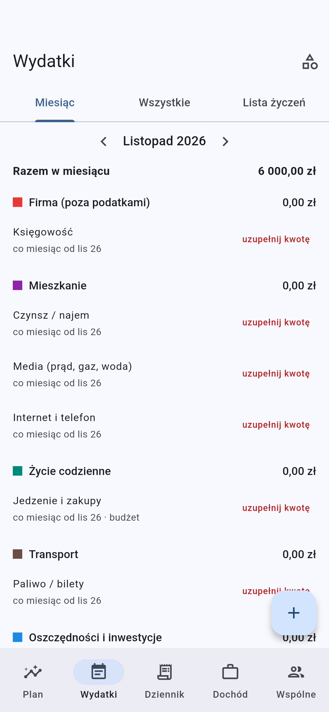
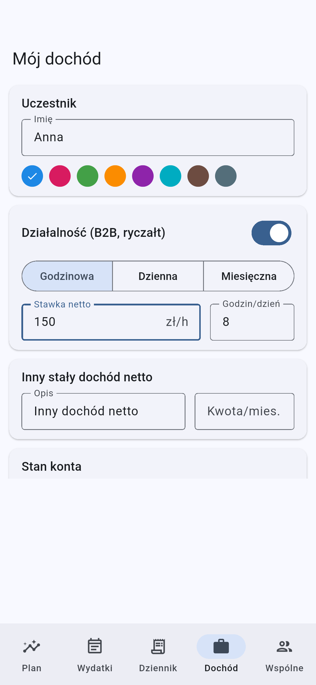
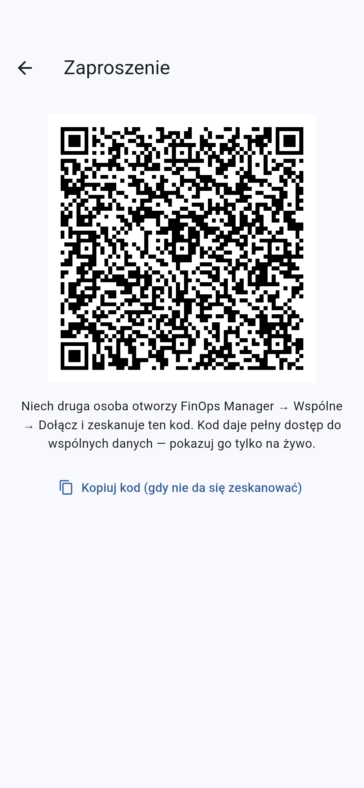

# finops.manager

Prosty planer finansów domowych (Flutter, Android) dla osób na **B2B
(ryczałt)**. Liczy dochód z dni roboczych, VAT, ryczałt i ZUS, rozpisuje
wydatki na miesiące i pozwala nałożyć plany kilku osób z jednego
gospodarstwa na siebie, z synchronizacją **P2P bez serwera** (Veilid, ten sam
stos co [p2p.communicator](https://github.com/TBS093A/p2p.communicator)).
Dołączenie do wspólnego planu odbywa się przez zeskanowanie kodu QR.

**Pobierz APK:** [najnowsze wydanie](https://github.com/TBS093A/finops.manager/releases/latest)
(arm64, Android 7+).

| Plan | Prognoza | Wydatki | Dochód | Zaproszenie |
|---|---|---|---|---|
|  |  |  |  |  |

Screenshoty robi CI na emulatorze (`integration_test/app_test.dart`).

## Co liczy

**Dochód (zakładka Dochód)**: stawka godzinowa × 8 h × dni robocze (albo
stawka dzienna lub miesięczna). Dni robocze to pon–pt bez polskich świąt
(Wielkanoc, Boże Ciało, Wigilia od 2025 itd.). Każdy miesiąc można
skorygować: dni urlopu, ręczna liczba dni, dodatkowa faktura.

**Podatki (ryczałt, wartości na 2026, do edycji)**:

| pozycja | wzór |
|---|---|
| VAT | 23% × przychód netto |
| ZUS społeczne | podstawa 5652,00 zł × (19,52% + 8% + 2,45% chorobowe + 1,67% wypadkowe) = 1788,29 zł |
| Fundusz Pracy | 2,45% × podstawa = 138,47 zł |
| zdrowotna | 9% × 60/100/180% przeciętnego wynagrodzenia (9228,64 zł) = 498,35 / **830,58** / 1495,04 zł, próg wg prognozowanego przychodu roku |
| ryczałt | 12% × (przychód − składki społeczne − 50% zdrowotnej), w pełnych złotych |

Przykład: 20 dni × 8 h × 125 zł = 20 000 zł netto daje VAT 4600 zł, ZUS
2757,34 zł i ryczałt 2136 zł, czyli 15 106,66 zł na rękę. W *Dochód →
Podatki i ZUS* ustawisz mały ZUS, ulgę na start, inną stawkę ryczałtu,
brak VAT, dobrowolne chorobowe i odliczenia składek. W *Parametrach na dany
rok* zmienisz kwoty bazowe, gdy w styczniu wejdą nowe.

**Wydatki (zakładka Wydatki)**:
- *co miesiąc*: od–do albo liczba rat (kredyty, raty, czynsz),
- *raz*: w wybranym miesiącu, opcjonalnie „odkładaj przez N miesięcy” (kwota
  rozkłada się na miesiące przed zakupem),
- *co rok*: domeny, ubezpieczenia,
- *kiedyś*: lista życzeń bez terminu; przyciskiem kalendarza wpisujesz ją w
  konkretny miesiąc,
- *budżet*: miesięczny limit (np. jedzenie), z którego schodzą zakupy
  wpisywane w **Dziennik**, z podglądem limitu na bieżący tydzień. W
  minionych miesiącach plan liczy to, co faktycznie wydano.

Kategorie są edytowalne (ikona w zakładce Wydatki). Kategorie typu
*Oszczędności / inwestycje* nie są wydatkiem: w bilansie są osobno. Przy
pierwszym uruchomieniu można dodać szablon typowych pozycji bez kwot (czynsz,
media, jedzenie, transport, księgowość, oszczędności).

**Plan (pulpit)**: bilans miesiąca, rozbicie dochodu, „procentowy plan
wydatków” (% wpływów), prognoza 12 miesięcy (dochód vs wydatki, stan konta),
budżety, nadchodzące wydatki jednorazowe i roczne, czyli to, o czym łatwo
zapomnieć.

## Wspólne planowanie (P2P)

Każdy uczestnik wypełnia **tylko swój** formularz na swoim telefonie. Na
pulpicie chipami wybierasz, czyje plany nałożyć (np. ja + partnerka), i
dostajesz wspólny bilans przychodów, wydatków i oszczędności. Wykres dochodu
jest wtedy podzielony kolorami osób.

1. Jedna osoba: *Wspólne → Załóż gospodarstwo → Zaproś uczestnika* (kod QR).
2. Druga osoba: *Wspólne → Dołącz → skanuje QR* (albo wkleja kod).

Pod spodem jest wzorzec z p2p.communicator:
- **roster**: rekord DHT z jednym wpisem na uczestnika. Jego klucz zapisu jest
  w QR, więc kod QR = członkostwo. Pokazuj go tylko na żywo.
- **outbox**: osobny rekord DHT każdego uczestnika. Klucz zapisu ma tylko jego
  telefon, inni tylko czytają.
- Dane uczestnika to JSON, skompresowany gzipem i pocięty na podklucze
  (≤ 32 KiB). Każdy kawałek niesie numer rewizji, więc nie da się skleić
  dwóch wersji. Nagłówek jest zapisywany na końcu.
- Wartości są szyfrowane kluczem rekordu (znają go tylko uczestnicy).
  Synchronizacja działa przez `watchDHTValues` plus odpytywanie co 30 s jako
  zabezpieczenie.

Planowanie działa w pełni offline. Sieć P2P startuje w tle.

## Struktura

```
lib/domain/   calendar (dni robocze, święta), tax (VAT/ryczałt/ZUS), models, planner
lib/data/     store (zapis lokalny JSON), starter_template (szablon pozycji)
lib/sync/     veilid_node, dht (z p2p.communicator), codec, invite, household_sync
lib/ui/       ekrany
```

## Rozwój

Flutter 3.47.9 (`/home/tbs093a/development/flutter/bin`). Pierwszy
`flutter test` kompiluje Veilid (Rust) dla hosta, więc trwa kilka minut.

```bash
flutter test
```

```bash
flutter analyze
```

CI/CD jest skopiowane z p2p.communicator (`.github/`):
- **premerge**: format, analiza, testy, debug APK, SAST/SCA (semgrep,
  CodeQL, gitleaks, osv), DAST na emulatorze (`integration_test/`).
- **postmerge**: to samo, a dodatkowo podpisany release APK jako GitHub
  release, MobSF i screenshoty na gałęzi `screenshots`.

Release wymaga sekretów `ANDROID_KEYSTORE_BASE64`,
`ANDROID_KEYSTORE_PASSWORD`, `ANDROID_KEY_ALIAS` i `ANDROID_KEY_PASSWORD`.
